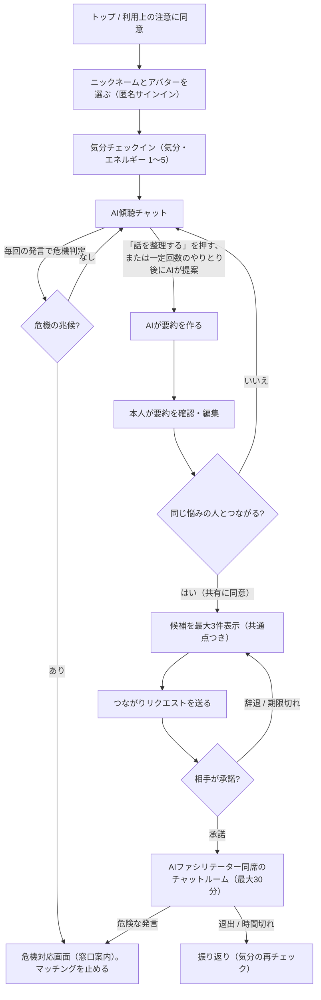
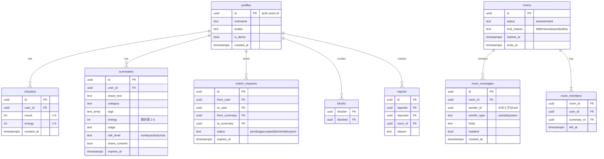

# 仕様書（ハッカソンMVP版）

> 参照元: [PROJECT.md](./PROJECT.md) / [VPC.md](./VPC.md) / [VM.md](./VM.md) / [BMP.md](./BMP.md)
> 前提: **JPHACKS・2日間のハッカソン**で「動くデモ」を作る。事業構想（BMC）のうち、2日で実現できないものは **除外** するか **代わりの案** に置き換えている（→ [§2 スコープ](#2-スコープ)）。

---

## 0. 決めること（着手前にチームで決める・10分）

| 項目 | 推奨（この仕様書の前提） | 決定 |
| :-- | :-- | :-- |
| プロダクト名 | ChatTomo | ChatTomo |
| ターゲット | **大学生**（人間関係・進路・孤立の悩み）。審査員・チームが想像しやすく、デモの台本も書きやすい | |
| 発表時間 | ○分 | |
| 技術構成 | Next.js(App Router) + TypeScript + Supabase + Claude API + Vercel（→ [§7](#7-技術構成)） | |

---

## 1. プロダクト概要

### 1.1 一言で
**「気力ゼロでも、AIのエスコートで『同じ痛みを分かち合える仲間』と安全に繋がれる」Webアプリ**

### 1.2 解決する課題（VPCより）
| 顧客のペイン | このMVPでの解消方法 |
| :-- | :-- |
| AI相談は定型の共感と窓口案内ばかりで、孤独が消えない | AI相談の **続きとして**、同じ悩みを持つ人間とつながれる |
| 自分から仲間を探す気力（検索・募集文・自己紹介）がない | AIが悩みを要約し、**候補を提案** する。本人は内容を確認して「つながる」を押すだけ |
| 見知らぬ人と話すのが怖い（否定・マウント・重い話に引きずられる） | **AIファシリテーターが同席** するチャットルーム、完全匿名、1タップでの退出・ブロック、共倒れを防ぐロジック |

### 1.3 差別化の軸（審査で見せるポイント）
1. **AI相談と仲間づくりを一つの流れにした**
2. **安全設計を「機能として」見せる**（危機を検知したら窓口へ案内、共倒れ防止、個人情報の自動マスク、同意の段階化）

---

## 2. スコープ

### 2.1 MVPで作るもの（Must）
| # | 機能 | 対応する価値（VM） |
| :-- | :-- | :-- |
| M1 | 匿名ではじめる（ニックネームとアバターを選ぶだけ）＋利用上の注意への同意 | 心理的安全性 |
| M2 | 気分チェックイン（気分・エネルギーを1〜5で自己申告） | 回復段階の把握（受動的トリアージの簡易版） |
| M3 | AI傾聴チャット（ストリーミング応答） | AI傾聴 |
| M4 | 悩みの要約 → **本人による確認・編集** → 共有への同意 | 行動ハードルの最小化、事前に状況を共有 |
| M5 | 危機検知（ルール＋LLMの二重判定）→ 危機対応画面（窓口案内）に切り替え、ピアとのマッチングを止める | リアルタイムの安全制御 |
| M6 | 類似ユーザー候補の提示（最大3件・共通点の説明つき） | プッシュ型ピアマッチング |
| M7 | つながりリクエスト → 相手が承諾（**双方の同意**） | 自発的なマッチング |
| M8 | AIファシリテーター同席のテキストチャットルーム（リアルタイム） | AIファシリテーター同席 |
| M9 | ルーム内の安全制御: 個人情報の自動マスク、危険な発言のブロック、否定的な発言の連続を検知して介入、30分の上限 | 共倒れ防止、会話のアシスト |
| M10 | 退出・ブロック・通報をすべての画面から1タップで | 心理的安全性 |
| M11 | 自分のデータを全削除 | 最小限のデータ |

### 2.2 余裕があれば（Should / Stretch）
| # | 機能 | メモ |
| :-- | :-- | :-- |
| S1 | 沈黙が続いたときにAIが話題を出す | クライアント側のタイマーで実装できる |
| S2 | リアクションだけのモード（テキストを打たずにスタンプで共感） | 「段階的コミュニケーション」の第1段階 |
| S3 | 埋め込みベクトル（pgvector）による類似検索 | MVPはタグ一致のスコアで代用（→ [§6](#6-マッチング仕様)） |
| S4 | 簡易管理画面（通報の一覧、ユーザーの停止） | |
| S5 | 時間をずらしたマッチング（相手がオフラインでも、リクエストを残しておける） | MVPでもDBに残る作りなので、通知UIを足すだけ |
| S6 | PWA化（ホーム画面に追加） | |

### 2.3 実現が難しいもの → 除外、または代わりの案
| BMC/VMにある要素 | 2日で難しい理由 | **ハッカソンでの代わりの案** |
| :-- | :-- | :-- |
| 精神科医・臨床心理士・公認心理師の監修ネットワーク（安全基準の策定） | 専門家の確保と契約が不可能 | **公開されている指針をもとに、自分たちで「安全チェックリスト」を作る**（厚生労働省「まもろうよ こころ」、ゲートキーパーの「TALKの原則」、WHOの自殺報道ガイドラインなど）。チェックリストは `docs/safety-checklist.md` に置き、プロンプトと判定ロジックに反映する。発表では **「将来は専門家の監修体制を作る」をロードマップとして示す** |
| 緊急時のエスカレーション体制（人間が対応する運用） | 24時間の運用者がいない | **公的な相談窓口の案内を自動で表示** する。アプリ側は「つなぐ」までで、対応はしない |
| 提携クリニックへの送客（専門家連携フィー） | 提携先がない | 危機対応画面と設定画面に **公的窓口・相談先の一覧** を出すだけにする |
| 音声・ビデオ通話（WebRTC）、変声、リアルタイム音声認識（STT）による監視 | 実装とモデレーションの負荷が大きい | **テキストチャットのみ**。テキストなら全発言を安全チェックにかけられるので、安全性の説明もしやすい。通話はロードマップに回す |
| 悪質ユーザーの即時BANと運用 | 審査する運用者がいない | **ブロックしたら即時に互いを非表示**。通報があったルームは自動で終了。BANは管理画面（S4）で手動 |
| ピアサポーターの評価・バッジ | 評価が安全を損なう恐れがあり、検証もできない | 除外 |
| 課金・B2B/B2Gライセンス | デモに不要 | 除外（発表資料のビジネスモデルで説明する） |
| アプリストアでの配布（iOS/Android） | 審査に間に合わない | **レスポンシブなWebアプリ**（Vercelで公開）。PWAはS6 |
| デイリー・チェックイン（プッシュ通知） | 通知基盤が必要 | **アプリを開いたときに気分チェックイン**（M2） |
| 同時接続ユーザー数の確保（コールドスタート） | 本番のユーザーがいない | 時間をずらしても成り立つリクエスト方式（M7）にする。デモでは **チームメンバーの別ブラウザ** と、`is_demo=true` を付けた **シードデータ** を使う。**AIボットに人間のふりをさせることは絶対にしない** |
| AIによる「回復段階」の高精度な推定 | 検証データがない | **自己申告（M2）＋AIの推定** を組み合わせ、粗い3段階で扱う（→ [§6](#6-マッチング仕様)） |
| 医師法などのリーガルチェック | 法務の担当がいない | **「AIは診断・治療をしない」「専門家の代わりではない」をUIとプロンプトの両方で徹底**。免責文を表示する |

---

## 3. ユーザーフロー



### 3.1 フローと対応フォルダ・ファイル一覧（どこに何が書いてあるか）

ユーザーが体験する流れ（ステップ A〜L）と、それらを動かしている実際のプログラムの場所（フォルダ・ファイル）の対応表です。

| フロー上のステップ | 担当画面（フロント） | API・ロジック（バックエンド・計算） | AI指示書（プロンプト） | どんな内容が書かれているか（かんたん解説） |
| :--- | :--- | :--- | :--- | :--- |
| **A: トップ / 同意** | `app/page.tsx` (P0) | — | — | サービスの説明と「専門家の代わりではない」という利用規約の同意画面です。 |
| **B: 匿名ではじめる** | `app/start/page.tsx` (P1) | `lib/supabase/client.ts` | — | メールアドレスを使わず、ニックネームとアイコンを選ぶだけで匿名ログインします。 |
| **C: 気分チェックイン** | `app/checkin/page.tsx` (P2) | `app/api/checkin/` | — | いまの「気分」と「心のエネルギー」を1〜5で記録し、無理な会話を防ぐ指標にします。 |
| **D: AI傾聴チャット** | `app/consult/page.tsx` (P3) | `app/api/chat/`<br>`lib/llm/claude.ts` | `prompts/consult.md` | AIが利用者の悩みを否定せず優しく聞き役に回るチャット画面です（内容はDBに保存せず秘密が守られます）。 |
| **R/X: 危機検知と案内** | `app/crisis/page.tsx` (P8) | `lib/safety/crisisKeywords.ts`<br>`lib/safety/detectCrisis.ts`<br>`lib/safety/hotlines.ts` | `prompts/risk.md` | 発言から自傷などの危険な兆候を二重（ルール＋AI）で察知し、即座に公的窓口（電話相談など）を案内してマッチングを止めます。 |
| **E/F: AI要約・本人の編集** | `app/summary/page.tsx` (P4) | `app/api/summarize/` | `prompts/summarize.md` | チャット内容から「相手に見せる短い要約」をAIが作成し、利用者が自分で直したり削ったりして確認する画面です。 |
| **G: 共有への同意** | `app/summary/page.tsx` (P4) | `app/api/summaries/`<br>`lib/safety/piiMask.ts` | — | 電話番号やSNSのIDが含まれていれば自動で「***」に伏せ字化し、本人が納得してボタンを押した時だけDBに保存します。 |
| **H: 候補の表示** | `app/candidates/page.tsx` (P5) | `app/api/match/candidates/`<br>`lib/matching/score.ts` | `prompts/common_ground.md` | 似た悩みを持つ人を計算して最大3人紹介します。双方が落ち込みすぎている（エネルギー2以下同士）ときは共倒れを防ぐため除外します。 |
| **I/J: リクエスト送信・承諾** | `app/requests/page.tsx` (P6) | `app/api/match/requests/` | — | 「話してみたい」とお互いに承諾（合意）した場合にだけ、チャットルームを作ります。無理強いはしません。 |
| **K: チャットルーム** | `app/rooms/[id]/page.tsx` (P7) | `app/api/rooms/[id]/`<br>`lib/facilitator/`<br>`lib/safety/piiMask.ts` | `prompts/facilitator.md`<br>`prompts/flow_analysis.md` | 2人だけのチャットにAIが進行役として同席します。連絡先の交換を伏せ字にし、否定的な会話が続いたときは助け舟を出します（最長30分）。 |
| **L: 退出・ブロック・通報** | `app/rooms/[id]/page.tsx`<br>`app/settings/page.tsx` (P9) | `app/api/rooms/[id]/leave`<br>`app/api/blocks/`<br>`app/api/reports/`<br>`app/api/me/` | — | いつでも1タップで安全に会話を抜けられます。嫌な相手をブロックしたり、全データを完全に消去することもできます。 |

---

### 3.2 フォルダ構成の超かんたん解説（フォルダごとの役割）

開発するときに「どのフォルダを触ればいいか」の目安です。

- 📂 **`app/`（画面と通信の窓口）**
  - 各画面の見た目（`app/(pages)`）と、フロントと裏側をつなぐ通信口（`app/api/`）が入っています。Next.js App Routerの規約に沿って配置されています。
- 📂 **`lib/safety/`（安全を守る仕組み）**
  - 危険な発言の検知辞書、電話番号やSNS IDの自動伏せ字（マスク）処理、厚生労働省などの相談窓口データなど、ユーザーを守る安全ロジックが集まっています。
- 📂 **`lib/matching/`（気の合う人を探す計算機）**
  - 悩みのジャンルやタグ、心の元気度から「どの人とどの人がマッチすると安心か」を計算する純粋な計算ロジック（スコアリングと除外フィルタ）です。
- 📂 **`lib/facilitator/`（AI司会者のルール）**
  - チャットルームで「沈黙が続いた」「否定的な空気が続いた」「終了5分前」などのタイミングを見張って、AIがいつどう話しかけるかを決める判定ルールです。
- 📂 **`prompts/`（AIへの指示テキスト）**
  - ClaudeなどのLLMに渡す「傾聴のしかた」「要約のルール」「危険判定の基準」「司会の振る舞い」などを書いたMarkdownファイル集です。コードに直接書かずにここで一元管理します。
- 📂 **`lib/supabase/`（データベース連携）**
  - データの保存や認証を行うSupabaseとの接続設定が入っています。
- 📂 **`tests/`（テストコード）**
  - 安全ロジックやマッチング計算が仕様通りに正しく動くかを自動検証するテストが入っています。

---

## 4. 画面一覧

| ID | 画面 | 主な要素 | 常に表示するもの |
| :-- | :-- | :-- | :-- |
| P0 | トップ / 利用上の注意 | サービス説明、注意事項（AIや仲間は専門家の代わりではない、緊急時は110/119）、同意チェック | — |
| P1 | はじめる | ニックネーム入力（実名らしい入力には注意を出す）、アバター選択（プリセット8種程度） | — |
| P2 | 気分チェックイン | 気分スライダー（1〜5）、エネルギースライダー（1〜5） | 「困ったときは」ボタン |
| P3 | AI相談 | チャット、「話を整理する」ボタン | 「困ったときは」ボタン、免責の一文 |
| P4 | 要約の確認 | 要約（相手に見せる文）、カテゴリ・タグ（編集できる）、「この内容で共有する / 共有しない」 | 「相手にはこの文だけが表示されます」 |
| P5 | 候補一覧 | 候補カード（ニックネーム、アバター、共有された要約、AIによる共通点の一文）、「つながりをお願いする」 | |
| P6 | リクエスト | 届いたリクエスト（承諾 / 辞退）、送ったリクエストの状態 | |
| P7 | チャットルーム | メッセージ一覧（ユーザー2人＋AIファシリテーター）、残り時間、退出・ブロック・通報 | 退出・ブロック・通報（ヘッダーに固定） |
| P8 | 危機対応 | 窓口一覧（電話番号はタップで発信）、落ち着くための短いガイド、「AI相談に戻る」 | — |
| P9 | 設定 | ニックネームの変更、**全データ削除**、窓口一覧 | |

**UIの原則**: 落ち着いた色（彩度の低い暖色系）、大きめのタップ領域、赤い警告色は危機対応画面だけで使う。文言はやさしく、断定しない。

---

## 5. 機能仕様

### 5.1 匿名サインイン（M1）
- Supabaseの匿名サインイン（`signInAnonymously`）を使う。メールアドレスや電話番号は集めない。
- ニックネームは2〜12文字。メールアドレス・電話番号・URLの形式は弾く。

### 5.2 AI傾聴チャット（M3）
- **会話の本文はDBに保存しない**（クライアントのメモリとsessionStorageのみ）。DBには、本人が承認した要約だけを保存する。
- サーバーは毎回、直近の会話（最大20往復）を受け取ってClaudeに送る。
- 応答方針（詳しくは `prompts/consult.md`）:
  - 傾聴・共感を基本にする。断定・説教・診断・治療の助言はしない
  - 感情をなぞり返すだけの返答を繰り返さず、整理と「小さな次の一歩」を手伝う
  - 1回の返答は3〜5文程度。質問は1つまで
  - 4往復を過ぎたら、「話を整理して、似た経験の人とつながることもできます」と **1回だけ** 提案する（強制しない）

### 5.3 危機検知（M5）— 最重要
**二重判定**で、どちらか一方でも該当したら危機として扱う。

| 層 | 方式 | タイミング | 目的 |
| :-- | :-- | :-- | :-- |
| L1 | ルールベース（キーワード・正規表現の辞書。`lib/safety/crisisKeywords.ts`） | 同期（送信直後） | 速い、確実、LLMが落ちていても動く |
| L2 | LLMによる分類（`prompts/risk.md`、JSONで出力） | AI相談では応答の生成と **並列** で実行。ルームではメッセージ配信後に非同期で実行 | 言い換えや文脈の理解 |

- 出力スキーマ: `{ "level": "none" | "caution" | "crisis", "categories": ["self_harm" | "suicide" | "abuse" | "violence" | "other"], "reason": string }`
- `crisis` の場合:
  - AI相談: 通常の応答を出さず、危機対応メッセージ＋P8へのボタンを出す。そのセッションでは **要約・マッチングに進めない**（`summaries.risk_level='crisis'` を記録し、候補から除外する）
  - ルーム: 本人のメッセージは **相手に配信しない**。本人にはP8を表示する。ルームはやわらかく終了し、相手には **理由を伏せて**「ルームが終了しました」とだけ伝える（本人の状態を他人に知らせない）
- `caution`（強い落ち込み、反芻など）: 応答の中で休憩を促す、視点を変える。マッチングの候補では「エネルギーが低い」扱いにする。
- **失敗したら安全側に倒す（fail-closed）**: L2がエラーやタイムアウト（5秒）になったら、AI相談の応答は続けるが、**そのセッションからのマッチングは止める**（「今は少し時間をおきましょう」と表示する）。

**表示する窓口**（`lib/safety/hotlines.ts`。公開前に公式サイトで番号と受付時間を必ず確認する）:
- 緊急時: 110 / 119
- よりそいホットライン（24時間・無料）: 0120-279-338
- #いのちSOS: 0120-061-338
- いのちの電話（ナビダイヤル）: 0570-783-556

### 5.4 要約と同意（M4）
- 「話を整理する」で、`prompts/summarize.md` を使い次のJSONを作る:
```json
{
  "share_text": "相手に見せる要約（2〜3文、固有名詞・所属・地名を含めない）",
  "category": "relationships | career | study | family | loneliness | health | other",
  "tags": ["友人関係", "孤立感"],
  "energy_estimate": 1,
  "stage_estimate": "struggling | coping | recovering"
}
```
- P4で本人が `share_text`・`category`・`tags` を **編集できる**。個人情報の検出（§5.7）を通す。
- 「共有する」を押したときだけ `summaries` に `share_consent=true` で保存する。有効期限は24時間（`expires_at`）。
- 押さなければ何も保存しない。

### 5.5 つながりリクエスト（M7）
- 送り手は候補から1人を選んでリクエストを送る（同時に送れるのは最大3件）。
- 受け手はP6で承諾 / 辞退。辞退の理由は聞かない。**辞退したことは送り手に「今回は見送られました」とだけ伝える**（傷つけにくい文言にする）。
- リクエストの期限は24時間。承諾されたらルームを作り、両者をP7へ。

### 5.6 チャットルームとAIファシリテーター（M8, M9）
- 参加者: ユーザー2人＋AIファシリテーター（`sender_type='ai'`）。
- **ルームの開始時**: ファシリテーターが、双方が **共有に同意した要約だけ** を使って自己紹介を促す（例: 「お二人とも、最近 人間関係で孤立感を感じているそうです。よければ、今日の気分をひとことずつ教えてください」）。
- **メッセージ送信の流れ**（クライアントから直接DBに書き込ませない）:
  1. クライアント → `POST /api/rooms/[id]/messages`
  2. サーバー: 個人情報のマスク（§5.7）→ L1の危機判定 → crisisなら配信しない
  3. DBに保存 → Supabase Realtimeで相手に届く
  4. 非同期でL2の判定と「流れの分析」を行い、必要ならファシリテーターが発言する
- **ファシリテーターが介入する条件**:
  | 条件 | 介入の内容 |
  | :-- | :-- |
  | 直近6件のうち4件以上が強く否定的（L2の `caution`、または分析で「反芻・共倒れの兆候」） | 視点を変える質問、または休憩の提案 |
  | 攻撃的・否定的な発言（相手を否定する、マウントを取る） | やわらかくルールを思い出させる。くり返したらルームを終了 |
  | 個人情報・外部SNSへの誘導 | マスクしたことを知らせ、匿名のまま話すよう促す |
  | 沈黙が3分続いた（S1） | 答えやすい話題を出す |
  | 開始から25分 | 「あと5分です」と伝え、振り返りを促す |
  | 30分 | 終了のあいさつをしてルームを閉じる |
- ファシリテーターは **会話を独占しない**。分析は最短でも3件ごとに1回、介入は最短2分の間隔をあける（デモで調整できるよう定数にする）。

### 5.7 個人情報の検出（M9）
- 正規表現で検出してマスク（`***`）: 電話番号、メールアドレス、URL、`@ハンドル`、「LINE」「インスタ」「X」などのIDを交換しようとする表現。
- 要約（§5.4）とルームのメッセージの両方に適用する。マスクしたら、送信者に「個人が特定できる情報は伏せました」と表示する。

### 5.8 退出・ブロック・通報（M10）
- **退出**: 1タップで即座に退出。相手には「〇〇さんが退出しました」。確認ダイアログは出さない（すぐ抜けられることを優先）。
- **ブロック**: 退出と同時に `blocks` に記録。以後、互いに候補に出ない。
- **通報**: 理由を選ぶ（攻撃的 / 個人情報を聞かれた / 不快な内容 / その他）。通報したらルームを自動で終了し、`reports` に記録する（会話ログは保存期間内だけ確認できる）。

### 5.9 データの削除と保存期間（M11）
| データ | 保存先 | 保存期間 |
| :-- | :-- | :-- |
| AI相談の会話 | ブラウザ（sessionStorage）のみ | タブを閉じるまで |
| 共有した要約 | DB | 24時間（`expires_at`） |
| ルームのメッセージ | DB | ルーム終了から24時間（通報があった場合は7日） |
| 気分チェックイン | DB | 7日 |
| ブロック・通報 | DB | 削除しない（安全のため） |

- 設定画面の「全データ削除」で、本人の profile・summaries・requests・自分のメッセージ・checkins を削除し、サインアウトする。
- 期限切れデータの自動削除は、MVPではアクセス時に除外するだけでよい（定期的な削除処理はStretch）。

---

## 6. マッチング仕様

MVPでは **埋め込みベクトルを使わず、構造化したタグでスコアを出す**（外部APIを減らし、結果を説明しやすく、デモで再現しやすくするため）。ベクトル検索はS3。

### 6.1 候補にする条件（すべて満たすこと）
- `share_consent = true` で、`expires_at` が未来
- `risk_level` が `crisis` ではない
- 自分ではない。どちらかがブロックしている相手ではない
- すでにリクエスト中、またはルームが進行中の相手ではない
- **共倒れを防ぐ条件**: 両者のエネルギーがどちらも2以下の組み合わせは除外する

### 6.2 スコア
```
energy = round((自己申告のエネルギー + AIの推定) / 2)   // 1〜5
score  = 0.5 * (categoryが一致 ? 1 : 0)
       + 0.3 * Jaccard(tagsA, tagsB)
       + 0.2 * stageBonus
stageBonus: 片方が recovering でもう片方が struggling/coping → 1.0（「少し先を行く人」とつなぐ）
            同じ stage → 0.6
            それ以外 → 0.3
```
- 上位3件を返す。`score < 0.3` の候補は出さない。0件のときは「今は近い人が見つかりませんでした。リクエストを残しておくと、似た人が来たときに見つけてもらえます」と表示する。
- 候補カードの「共通点の一文」は、**双方が共有に同意した `share_text` だけ** を入力にして生成する（`prompts/common_ground.md`）。

---

## 7. 技術構成

| 層 | 採用 | 理由 |
| :-- | :-- | :-- |
| フロントエンド | Next.js 15 (App Router) + TypeScript + Tailwind CSS (+ shadcn/ui) | 1つのリポジトリでAPIも書ける |
| 認証 / DB / リアルタイム | Supabase（匿名認証、Postgres、Row Level Security、Realtime） | 2日でリアルタイムチャットまで作れる |
| LLM | Claude API（`@anthropic-ai/sdk`）。応答と要約は高性能なモデル、危機判定と分析は速いモデル。モデルIDは環境変数で切り替える | |
| デプロイ | Vercel | |
| 埋め込み（Stretch） | pgvector ＋ 埋め込みAPI（Voyage AI など） | S3 |

### 7.1 環境変数
```
NEXT_PUBLIC_SUPABASE_URL=
NEXT_PUBLIC_SUPABASE_ANON_KEY=
SUPABASE_SERVICE_ROLE_KEY=        # サーバー専用。クライアントに出さない
ANTHROPIC_API_KEY=                # サーバー専用
ANTHROPIC_MODEL_MAIN=             # 応答・要約・ファシリテーター用
ANTHROPIC_MODEL_FAST=             # 危機判定・流れの分析用
```

---

## 8. データモデル（Supabase / Postgres）



### 8.1 各テーブルの役割とかんたん解説（何がどこで保存されるか）

データベース（Supabase / Postgres）に用意されている9つのテーブルについて、どのような目的で何が保存され、どの画面やAPIで使われているかの対応表です。

| テーブル名 | 日本語での役割 | 主な保存内容 | 対応する画面・API | かんたん解説（使い道） |
| :--- | :--- | :--- | :--- | :--- |
| **`profiles`** | 匿名プロフィール | ニックネーム、アバター番号、デモ用フラグ | P1（はじめる）、P9（設定）<br>`/api/me` | メールアドレスや本名は持たず、アプリ内で表示する「仮の名前とアイコン」だけを管理します。 |
| **`checkins`** | 気分チェックイン | 気分（1〜5）、エネルギー（1〜5） | P2（気分入力）<br>`/api/checkin` | 今の気分の良さと心の元気度（エネルギー）の自己申告値です。無理なマッチングを防ぐ安全基準に使います。 |
| **`summaries`** | 共有用の悩み要約 | 相手に見せる要約文、カテゴリ、タグ、推定エネルギー、回復段階、危機判定、共有同意フラグ、有効期限 | P4（要約確認）、P5（候補表示）<br>`/api/summarize`<br>`/api/summaries`<br>`/api/match/candidates` | AI相談から作られた「相手に見せてよい要約」です。本人が同意した時だけ保存され、24時間で自動的に失効します。危険判定されたものは候補から除外されます。 |
| **`match_requests`** | つながりリクエスト | 送信者、受信者、紐づく要約ID、ステータス（申請中/承諾/辞退/期限切れ）、有効期限 | P6（リクエスト一覧）<br>`/api/match/requests`<br>`/api/match/requests/[id]/respond` | 「この人と話してみたい」というお誘いです。お互いが承諾した場合のみ次のチャットルームが作られます（24時間で失効）。 |
| **`rooms`** | チャットルーム | ルーム状態（進行中/終了）、終了理由（退出/時間切れ/通報/安全検知）、開始・終了予定時刻 | P7（チャットルーム）<br>`/api/rooms/[id]/...` | マッチングした2人とAIファシリテーターが入る部屋の情報です。最長30分で自動終了します。 |
| **`room_members`** | ルーム参加者 | ルームID、ユーザーID、要約ID、退出時刻 | P7（チャットルーム）<br>`/api/rooms/[id]/leave` | 誰が部屋にいるかを管理します。どちらか1人が退出すると退出時刻が記録され、部屋は終了に向かいます。 |
| **`room_messages`** | チャットメッセージ | メッセージ本文、送信者タイプ（人間/AI/システム）、伏せ字フラグ、送信日時 | P7（チャットルーム）<br>`/api/rooms/[id]/messages` | ルーム内の会話です。連絡先は自動で「***」に伏せ字化され、危険な言葉は相手に届く前にシャットアウトされます。 |
| **`blocks`** | ブロックリスト | ブロックした人、ブロックされた人 | P7（チャットルーム）<br>`/api/blocks` | 「この人とは二度と関わりたくない」という記録です。候補やリクエストに一切表示されなくなります。 |
| **`reports`** | 通報記録 | 通報した人、された人、部屋ID、通報理由 | P7（チャットルーム）<br>`/api/reports` | 暴言や規約違反があったときの通報データです。通報が押された時点でそのチャットルームは即座に終了します。 |

---

### 8.2 安全設計とデータモデルのポイント（なぜこの形なのか）

- 🔒 **「AI相談の会話本文」テーブルが存在しない理由（プライバシー保護）**
  - 最もデリケートな「AIとの1対1の相談チャット」の会話ログは、**DBには一切保存しません**。ブラウザの一時メモリ（`sessionStorage`）にだけ置き、タブを閉じれば消去されます。DBに残るのは、本人が読んで納得した「短い要約（`summaries`）」だけです。
- ⏳ **24時間で消える時限設計（`expires_at`）**
  - 要約（`summaries`）やリクエスト（`match_requests`）は、24時間経つと期限切れになります。「ずっと過去の悩みがネット上に残り続ける不安」を解消します。
- 🛡️ **安全チェックを絶対に迂回させない仕組み（RLS）**
  - 会話メッセージ（`room_messages`）は、ブラウザから直接DBに追加（INSERT）できないように権限（RLS）で制限しています。必ずサーバーの安全チェックAPI（危険検知・個人情報の伏せ字化）を通ったメッセージだけが保存されます。

---

### 8.3 Row Level Security の方針
- `profiles`: 誰でも `nickname` と `avatar` だけ読める（ビューで公開）。書き込みは本人だけ。
- `summaries`: 本人は自分の行を読み書きできる。他人の行はクライアントから直接読めない（候補はAPI経由で返す）。
- `room_messages`: **SELECTはルームのメンバーだけ**。**INSERTはクライアントから禁止**（service roleを使うAPIだけが書き込む）。→ 安全チェックを迂回できないようにする。
- `match_requests` / `rooms` / `room_members`: 当事者だけ読める。書き込みはAPI経由。

---

## 9. API一覧（Next.js Route Handlers）

| メソッド | パス | 説明 |
| :-- | :-- | :-- |
| POST | `/api/checkin` | 気分チェックインを保存 |
| POST | `/api/chat` | AI相談（ストリーミング）。L1＋L2の危機判定を並列で行う。crisisなら `{type:"crisis"}` を返す |
| POST | `/api/summarize` | 会話から要約のJSONを作る（まだ保存しない） |
| POST | `/api/summaries` | 本人が確認した要約を共有に同意して保存（個人情報マスクを再適用） |
| GET | `/api/match/candidates` | 候補を最大3件（共通点の一文つき） |
| POST | `/api/match/requests` | リクエストを送る |
| GET | `/api/match/requests` | 送った / 届いたリクエスト |
| POST | `/api/match/requests/[id]/respond` | 承諾 / 辞退。承諾ならルームを作る |
| POST | `/api/rooms/[id]/messages` | メッセージ送信（マスク → L1 → 保存 → 非同期でL2とファシリテーター） |
| POST | `/api/rooms/[id]/leave` | 退出 |
| POST | `/api/rooms/[id]/facilitate` | 沈黙・時間経過などのイベントでファシリテーターを呼ぶ（クライアントのタイマーから） |
| POST | `/api/blocks` | ブロック（ルームにいれば退出も行う） |
| POST | `/api/reports` | 通報（ルームを終了） |
| DELETE | `/api/me` | 全データ削除 |

---

## 10. AIプロンプト一覧（`prompts/`）

| ファイル | 用途 | モデル | 出力 |
| :-- | :-- | :-- | :-- |
| `consult.md` | AI傾聴 | MAIN | テキスト（ストリーミング） |
| `risk.md` | 危機判定 | FAST | JSON |
| `summarize.md` | 要約・タグ付け | MAIN | JSON |
| `common_ground.md` | 候補の共通点の一文 | FAST | テキスト（40字以内） |
| `facilitator.md` | ルームのファシリテーター | MAIN | テキスト、または「介入しない」 |
| `flow_analysis.md` | ルームの流れの分析（否定の連続・攻撃性） | FAST | JSON |

- システムプロンプトはコードに直書きせず、`prompts/` から読み込む。変更はPRでレビューする。
- すべてのプロンプトに共通の安全ルールを入れる: 診断・治療をしない、専門家の代わりではない、他のユーザーの情報を同意なく伝えない、個人情報の交換を促さない。

---

## 11. 安全チェックリスト（専門家監修の代わり）

`docs/safety-checklist.md` として管理し、デモ前に全項目を確認する。

- [ ] 危機を表す表現（直接的な表現・遠回しな表現・ひらがな・絵文字混じり）のテスト20件で、すべてP8に切り替わる
- [ ] crisisと判定されたセッションの要約は、候補に出ない
- [ ] L2をわざと失敗させても、マッチングに進めない（fail-closed）
- [ ] ルームで危機を表す発言をしても、相手には配信されず、理由も伝わらない
- [ ] 電話番号・メールアドレス・SNSのIDがマスクされる（要約とルームの両方）
- [ ] 退出・ブロック・通報がすべての画面から1タップでできる
- [ ] エネルギーが2以下の人同士がマッチしない
- [ ] AIが診断名を断定したり、薬・治療について助言したりしない（10パターンで確認）
- [ ] 「AIや仲間は専門家の代わりではない」がP0・P3・P8に表示される
- [ ] 窓口の電話番号と受付時間を、公式サイトで確認した（確認日: ____）
- [ ] リポジトリに実在の相談内容・APIキーが含まれていない

参考にする公開資料: 厚生労働省「まもろうよ こころ」、ゲートキーパー養成研修テキスト（TALKの原則: Tell / Ask / Listen / Keep safe）、WHO「自殺対策を推進するためにメディア関係者に知ってもらいたい基礎知識」。

---

## 12. 2日間のスケジュール（4人チームの想定）

| 時間 | フロント / UI | バックエンド / DB | AI・プロンプト / 安全 | 企画・発表 |
| :-- | :-- | :-- | :-- | :-- |
| **Day1 午前** | Next.jsの雛形、画面遷移（P0〜P4はモック） | Supabaseのプロジェクト、スキーマ、RLS、匿名認証 | `consult.md` / `risk.md`、L1キーワード辞書 | 名前、ペルソナ、デモの台本 |
| **Day1 午後** | P3 AI相談（ストリーミング）、P8 危機対応 | `/api/chat`、`/api/summarize`、`/api/summaries` | 危機判定のテストケース、`summarize.md` | 安全チェックリストの作成 |
| **Day1 夜** | P4 要約確認、P5 候補 | マッチングのスコア、`/api/match/*`、シードデータ | 個人情報マスク、`common_ground.md` | スライドの骨子 |
| **Day2 午前** | P6 リクエスト、P7 ルーム（Realtime） | `/api/rooms/*`、退出・ブロック・通報 | `facilitator.md` / `flow_analysis.md`、介入のロジック | デモ動画の撮影準備 |
| **Day2 午後** | 仕上げ、レスポンシブ対応、P9 | Vercelへのデプロイ、全データ削除 | 安全チェックリストを全項目確認 | 発表練習 |
| **Day2 発表前** | **機能を止めて（フィーチャーフリーズ）、通しのリハーサル。予備のデモ動画を用意** | | | |

> **時間がないときに削る順番**: S系すべて → 共通点の一文（固定文にする） → AIファシリテーターの流れ分析（開始時・25分・30分の定型の介入だけ残す）。**危機検知・同意・退出/ブロックは絶対に削らない。**

---

## 13. デモのシナリオ（3分）

1. **ユーザーA（スマホ）**: 匿名ではじめる → チェックイン（エネルギー3） → AIに「サークルで浮いていて、誰にも話せない」と相談
2. AIが傾聴したあと、つながることを提案 → 要約を確認し、少し編集して「共有する」
3. 候補に **ユーザーB（チームメンバーのPC）** が表示される（共通点:「新しい環境で居場所を探している」）→ リクエスト
4. Bが承諾 → ルームが始まり、AIファシリテーターが自己紹介を促す
5. AがLINEのIDを送ろうとする → **自動でマスク**され、ファシリテーターが匿名のまま話すよう促す
6. 否定的な発言が続く → ファシリテーターが視点を変える質問をする
7. **ユーザーC（別のブラウザ）**: AI相談で危機を表す表現 → **即座に危機対応画面**。候補一覧に進めないことを見せる
8. Aが1タップで退出 → 振り返り（気分の再チェック）
9. ロードマップ: 専門家の監修体制、通話、大学・自治体への導入（BMCより）

---

## 14. 発表で伝える「将来の構想」（今回は作らない）
- 精神科医・公認心理師による監修と、安全基準の共同策定
- 段階的なコミュニケーション（リアクション → テキスト → 変声つき音声 → ビデオ）
- 大学の学生相談室・自治体・企業のEAPへの導入（B2B2C）、相談窓口への連携
- 利用データ（匿名・集計済み）による孤立対策の効果測定

